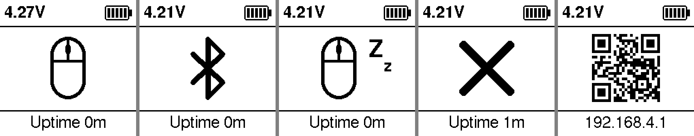

# MouseJiggerInk — 墨水屏蓝牙鼠标抖动器（M5Stack CoreInk）

基于 **[M5Stack CoreInk](https://docs.m5stack.com/zh_CN/core/coreink)** 的低功耗蓝牙（BLE）鼠标模拟器：
按设定的随机间隔把鼠标挪动几个像素，让电脑以为有人在用，**防止进入休眠、锁屏或"离开"状态**。

设备在电脑上就是一个普通的蓝牙鼠标（默认名 `RAPOO BT MOUSE`），不需要装任何驱动或软件。
**电子墨水屏**常显当前状态，靠**内置 390mAh 电池**就能用一整个工作日，
模拟关闭或处于计划暂停时段时可以待机好几天。

> 本项目是 [mouseJigger](https://github.com/DuanWeiye/mouseJigger)（ATOM Lite + Arduino 版）的移植，
> 基于 **ESP-IDF v5.4.2** 从零重写，没有 Arduino 依赖。



<sub>从左到右：工作中 · 等待电脑连接 · 计划暂停时段 · 模拟关闭 · WiFi 配置二维码（串口截取的实际画面）</sub>

---

## ✨ 特性

- 🖱️ **真·硬件鼠标**：标准 BLE HID（HOGP）鼠标，系统无法区分真假；绑定后能自动回连。
- 🎲 **随机抖动**：间隔（默认 5～8 分钟）和幅度（默认 2～5 像素）都可设，X/Y 方向随机。
- 🖼️ **墨水屏状态**：画面不刷新就不耗电。中间一个大图标显示状态，上方是电池电压和 5 格电量，下方是已运行时间。
- 🗓️ **周计划**：工作日、周末各 24 格（每格 1 小时）。时间来自板载 **BM8563 RTC**，不联网也能按计划走；时区跟随配置时所用的手机。
- 🔋 **省电**：
  - 模拟关闭或计划暂停时段把整个蓝牙关掉，自动进入浅睡；
  - 墨水屏刷完立即给面板断电；
  - 配置用的 WiFi 只在需要时开。
- 📶 **扫码配置**：按一下按钮，屏上显示热点二维码，手机扫码即可进入配置页；打开配置页时用手机时间自动校准设备时钟。
- 🔘 **两个按键搞定**：开关模拟、开关 WiFi、关机、恢复出厂。

---

## 🖥️ 屏幕

| 图标 | 含义 |
|---|---|
| 鼠标 | 模拟开启，已连接电脑，正在按计划工作 |
| 蓝牙 | 模拟开启，等待电脑连接（配对/加密完成才算连上） |
| 鼠标 + Zz | 当前处于周计划不允许移动的时段，蓝牙已关闭省电，到时间自动恢复 |
| ✕ | 模拟关闭 |
| 二维码 | WiFi 配置模式，下方显示配置页地址 `192.168.4.1` |

- **上方**：电池电压 + 5 格电量。CoreInk 没有检测充电的引脚，所以不显示充电标志。
- **下方**：`Uptime 3h 6m` 形式的已运行时间。满一天后放不下时缩成 `Up 1d 2h 3m`；关机后屏幕清空，不再显示。
- **刷新规则**：
  - 图标和二维码变化时立即刷新；
  - 电压、电量格和 Uptime 统一在每分钟开始时（hh:mm:00）更新（内容没变就不刷）；
  - 每小时第一次刷新会做一次清底，屏幕闪一下以清除残影。

---

## 🔘 按键

| 按键 | 短按（松开时生效） | 长按 5 秒 |
|---|---|---|
| **顶部按钮** | 开启 WiFi、显示二维码；再按一次关闭 WiFi（整机重启，约 2 秒回到正常界面） | **恢复出厂**：清除蓝牙配对与全部设置后重启 |
| **拨轮按下** | 模拟开 / 关（断电后保持） | **关机**：屏幕清空后断电 |
| 拨轮上 / 下 | 不使用 | — |

- 侧面电源键用来开机。插着 USB 时无法真正断电，"关机"会改为深睡，按电源键唤醒。
- 电池电压连续 3 分钟低于 3.4V 会自动关机，同样会清屏。

---

## 📶 首次使用与配置

1. **配对**：开机后，在电脑的蓝牙设置里搜索并添加 `RAPOO BT MOUSE`。屏幕从蓝牙图标变成鼠标图标就表示连上了。
2. **进入配置页**：
   1. 按一下顶部按钮，屏幕显示二维码；
   2. 用手机扫码，加入开放热点 `MouseJigger`，系统一般会自动弹出配置页（没弹出就在浏览器打开 `http://192.168.4.1/`）；
   3. 页面打开时，会自动用手机的时间和**时区**校准设备时钟（RTC），周计划按这个本地时间执行。
      出厂默认时区是 UTC+9（日本）。不含夏令时规则，夏令时地区在切换后重新打开一次配置页即可。
3. **可设置的项目**：
   - 蓝牙设备名（最多 31 字节）；
   - 移动间隔（秒）和幅度（像素）；
   - 周计划；
   - 在页面上开关模拟。
4. **完成**：点「完成，关闭 WiFi」，或再按一次顶部按钮。
   忘了关也没关系：**关掉配置页 10 分钟后 WiFi 会自动关闭；不管怎样最长只开 30 分钟**。

> 热点不设密码：它只在你按下按钮后临时开启，设置完就关。

---

## 🔋 续航

| 状态 | 估算平均电流 | 估算续航（390mAh） |
|---|---|---|
| 模拟开启，已连接电脑 | ~12–20 mA | 约 16–27 小时 |
| 模拟关闭 / 计划暂停时段 | ~1.5–3 mA | 约 4–9 天 |
| WiFi 配置中 | ~100–120 mA | 临时使用（自动关闭） |

> 以上是估算值，还没有用仪器实测。浅睡占比是实测的：蓝牙关闭时约 98% 的时间在浅睡，每分钟只醒一次刷屏。

**为什么蓝牙开着时耗电高？** ESP32 要在蓝牙开着的同时浅睡，必须外接 32.768kHz 晶振；
CoreInk 的 GPIO32/33 用作 Grove 口，板上没有这颗晶振。这种情况下 ESP-IDF 会一直禁止浅睡，
只能靠动态调频（空闲时 40MHz，实测约 77% 的时间跑在 40MHz）、BT modem sleep，
以及连接建立后请求较长的连接间隔 + 从机延迟来省电。
所以本项目让蓝牙**只在"模拟开启且周计划允许"时运行**，其余时间整个关掉。

---

## 🧰 硬件

只需要一台 **M5Stack CoreInk**，不用额外接线。

| 功能 | GPIO |
|---|---|
| 墨水屏 GDEW0154M09：BUSY / RST / DC / CS / SCK / MOSI | 4 / 0 / 15 / 9 / 18 / 23 |
| 电源保持 | 12 |
| 绿色 LED（低电平亮） | 10 |
| 电池电压（分压 ×25.1/5.1，ADC1） | 35 |
| 顶部按钮 / 拨轮按下 / 电源键 | 5 / 38 / 27 |
| BM8563 RTC（I2C 地址 0x51） | SDA 21 / SCL 22 |

---

## 🚀 编译与烧录

**环境**：ESP-IDF **v5.4.2**（目标芯片 esp32）。M5GFX 通过 IDF 组件管理器自动下载（版本锁在 `dependencies.lock`）。

```bash
git clone https://github.com/DuanWeiye/MouseJiggerInk.git
cd MouseJiggerInk

./build.sh                      # 编译（自动 source ESP-IDF；路径可用 IDF_DIR=... 指定）

# 烧录：设备按 USB 序列号锁定，先把 COREINK_DEV 指向你的板子
ls /dev/serial/by-id/
COREINK_DEV=/dev/serial/by-id/usb-Silicon_Labs_CP2104_..._XXXX-if00-port0 ./build.sh -f
```

`build.sh` 的其它用法：

| 参数 | 作用 |
|---|---|
| `-f` | 编译 + 完整烧录（bootloader、分区表、app） |
| `-a` | 编译 + 只烧 app（日常迭代用） |
| `-w` | 不编译，直接烧已有产物 |
| `-l [秒]` | 复位后抓 N 秒串口日志 |
| `-L [秒]` | 不复位，被动抓 N 秒日志 |
| `-m` | 交互式串口监视器 |
| `-c` | 清理（改了 `sdkconfig.defaults` 后要做） |

烧录地址和 flash 参数读取 IDF 生成的 `build/flash_args`。

---

## 🛠️ 串口调试

```bash
tools/serial_cmd.py stat                          # 打印一行状态
tools/serial_cmd.py snap --png build/snap.png     # 把当前屏幕画面存成 PNG
tools/serial_cmd.py jiggle                        # 立刻动一下鼠标
tools/serial_cmd.py "simtest 60;snap 2500" 6      # 关模拟 60 秒后自动打开，2.5 秒后截图
tools/serial_cmd.py "schedtest 60;snap 2500" 6    # 视同计划暂停 60 秒（只在内存里，不改设置）
```

另外还有 `clean`（清底重刷）、`sim`、`wifi`、`blecycle`（重启蓝牙协议栈）这几条。
多条指令用 `;` 隔开一次发出。蓝牙关闭（浅睡）时串口收不到指令，所以测试浅睡路径的指令都会到点自动恢复。

---

## 📁 代码结构

```
main/
├── app_main.cpp   主状态机：唯一改状态、唯一画屏的地方；其它任务只投事件
├── ble_hid.c      NimBLE HID 鼠标（可整体启停，含 Windows 回连加固）
├── epd.cpp        GDEW0154M09 墨水屏驱动（差分刷新 / 清底刷新 / 刷完断电）
├── ui.cpp         用 M5Canvas 离屏画布画界面、二维码
├── portal.cpp     WiFi 热点 + DNS 强制门户 + HTTP 配置接口
├── rtc.cpp        BM8563 RTC（读数校验、系统时间校正）
├── settings.cpp   NVS 设置
├── board.cpp      电源保持、按键、LED、电池 ADC
└── web/index.html 配置页（编进固件）
```

---

## 📝 实现笔记（踩过的坑）

- **墨水屏驱动是自己写的**。M5GFX 的局刷模式不维护面板的"旧画面"寄存器，差分基准越刷越偏，残影会累积。
  这里每次刷新都显式写入"旧 = 当前显示内容、新 = 目标画面"，刷完立即给面板断电。
  命令序列与 LUT 来自 LovyanGFX / M5GFX 的 `Panel_GDEW0154M09`（FreeBSD 许可，见文末）。
- **RTC 慢时钟不能选 `RTC_CLK_SRC_INT_8MD256`**：实测在 IDF 5.4.2 下，ESP32 第一次进自动浅睡就卡死，再也醒不来。
  所以保持默认的 150kHz RC，系统时间每分钟用 BM8563 校正一次。
- **lwIP 一旦启动就停不掉**：它的 1 秒周期定时器会让浅睡每秒被叫醒一次。
  所以 TCP/IP 栈推迟到第一次开 WiFi 时才初始化，关 WiFi 时整机重启。
  开机时刻存在 RTC 内存（`RTC_NOINIT`），软件重启后 Uptime 不清零。
- **定时用单调时钟**：分钟节拍和移动排程都用 `esp_timer`。墙钟会被校时改动，只用于显示和周计划。
- **蓝牙反复启停时**，NimBLE 会打一条 `failed to configure restored IRK`，这是无害的：
  ESP32 用主机侧地址解析，解析列表在 deinit 时不清空，条目本来就还在。
  前提是本机地址保持 public，不要启用本机 RPA。
- **CoreInk 串口的自动复位**：DTR 先拉低再拉高才会复位，正常打开串口不会复位。

---

## 📜 许可

[MIT License](LICENSE) © 2026 DuanWeiye

`main/epd.cpp` 中的面板初始化序列与 LUT 取自 [LovyanGFX](https://github.com/lovyan03/LovyanGFX)
（© 2020 lovyan03，FreeBSD 许可），按其要求保留声明，见 [THIRD_PARTY_NOTICES.md](THIRD_PARTY_NOTICES.md)。
构建时通过组件管理器获取的 [M5GFX](https://github.com/m5stack/M5GFX) 为 MIT 许可（© 2021 M5Stack）。
